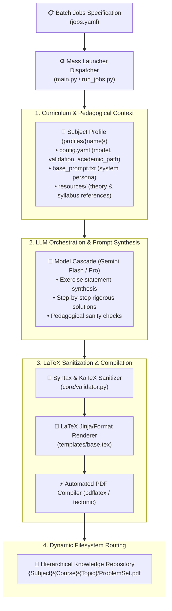

# 📚 Universal Exercise Generator — Autonomous AI Curriculum & Problem-Set Engine

[](https://python.org)
[](https://ai.google.dev/)
[](templates/)
[](LICENSE)

> An autonomous batch-generation factory producing publication-grade academic STEM problem sets and verified solution keys from declarative YAML curriculum specifications. Deployed in production at **Academia Ítaca** to generate hundreds of verified academic problem sets spanning secondary education to elite university entrance exams.

---

## 🏛️ Pipeline Architecture



---

## ⚡ Key Architectural Highlights

### 1. Declarative Curriculum Specifications
Every academic subject and level is declared as an isolated profile without modifying application code:
```yaml
# profiles/matematicas_2bach_ciencias/config.yaml
name: "Matemáticas II — 2º Bachillerato Ciencias"
subject: "Matemáticas"
level: "2_BACH"
academic_path: "1. Matemáticas/Matemáticas - 2º BACH/Ciencias/Ítaca"
validation:
  require_step_by_step_solutions: true
  enforce_latex_math_blocks: true
```

### 2. Autonomous Mass Batch Launcher
Enables batch execution of entire multi-topic curriculum syllabi in a single scheduled execution pass via `jobs.yaml`:
```bash
python main.py
# Select Option 11 (MASS LAUNCHER)
```

### 3. LaTeX Sanitization & Robust Fallbacks
Raw LLM outputs frequently produce invalid LaTeX escapes or conflicting symbol definitions. 
- `core/validator.py` applies AST-like regex sanitization to mathematical delimeters (`$`, `$$`, `\begin{align*}`).
- Verifies balance of delimiters before spawning compilation subprocesses.

---

## 🚀 Quickstart

```bash
# Clone the repository
git clone https://github.com/MiguelMartinVieira/universal-exercise-generator.git
cd universal-exercise-generator

# Install dependencies via uv
uv sync

# Configure API credentials
cp .env.example .env

# Run generator CLI
python main.py
```
