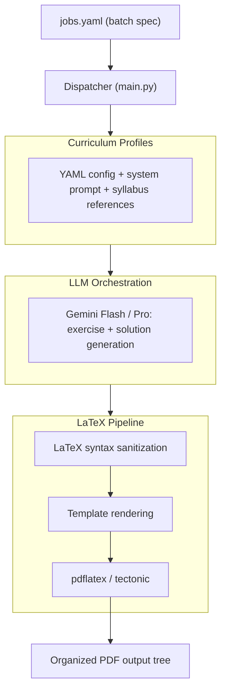

# Universal Exercise Generator

[](https://python.org)
[](LICENSE)

A batch generator for STEM problem sets with solutions. Define a curriculum profile in YAML, point it at an LLM (Gemini or OpenAI), and it produces validated LaTeX exercises with step-by-step solutions compiled to PDF.

Built for and used in production at [Academia Ítaca](https://itacacademia.com) to generate hundreds of worksheets — from secondary school math to university entrance exams (ICADE, CEU).

## How it works



### Curriculum profiles

Each subject is a self-contained directory with its own config, prompt, and reference materials:

```yaml
# profiles/matematicas_2bach_ciencias/config.yaml
name: "Matemáticas II — 2º Bachillerato Ciencias"
subject: "Matemáticas"
level: "2_BACH"
academic_path: "1. Matemáticas/Matemáticas - 2º BACH/Ciencias/Ítaca"
validation:
  require_step_by_step_solutions: true
  enforce_latex_math_blocks: true
```

### LaTeX sanitization

LLM output frequently has broken LaTeX — unbalanced delimiters, weird escape sequences, conflicting symbol definitions. The validator (`core/validator.py`) catches and fixes these before compilation.

## Quickstart

```bash
git clone https://github.com/MiguelMartinVieira/universal-exercise-generator.git
cd universal-exercise-generator
uv sync
cp .env.example .env   # add your API key
python main.py
```

## License

MIT
